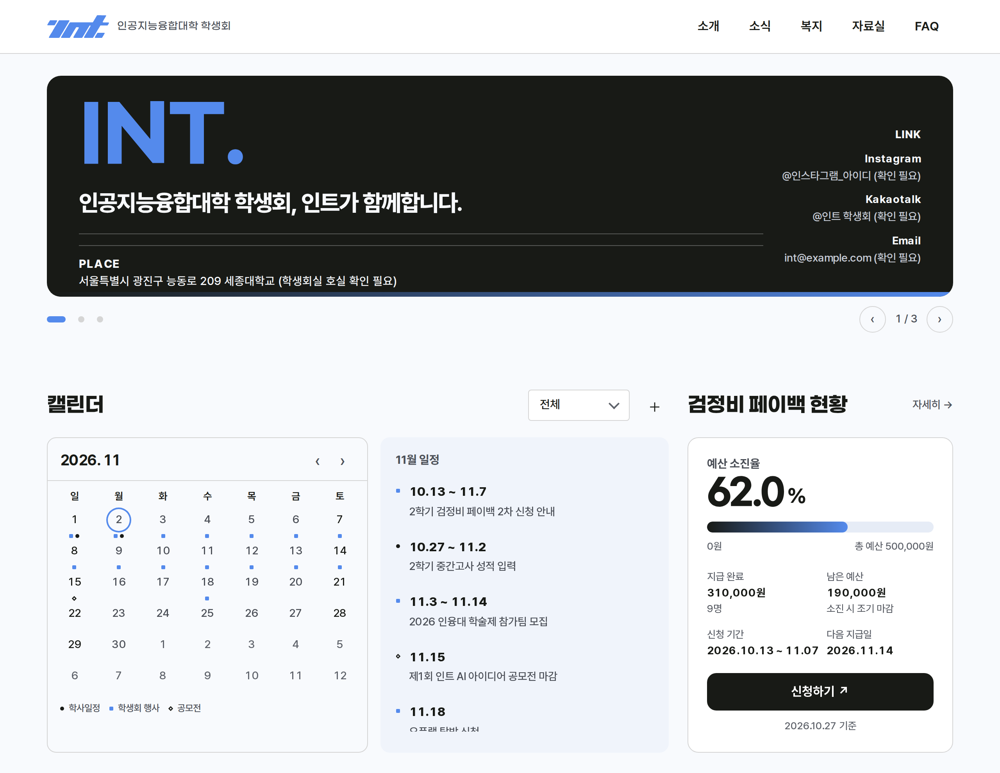
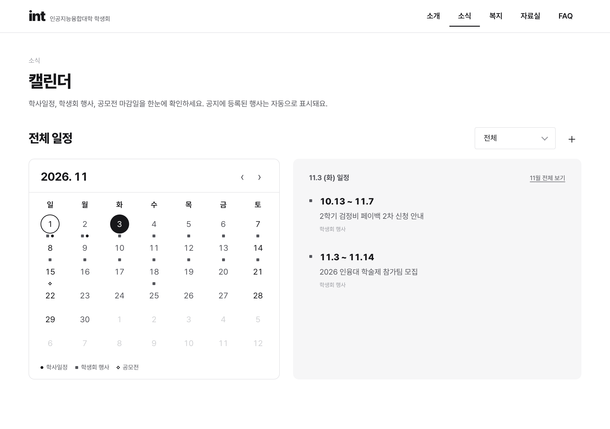
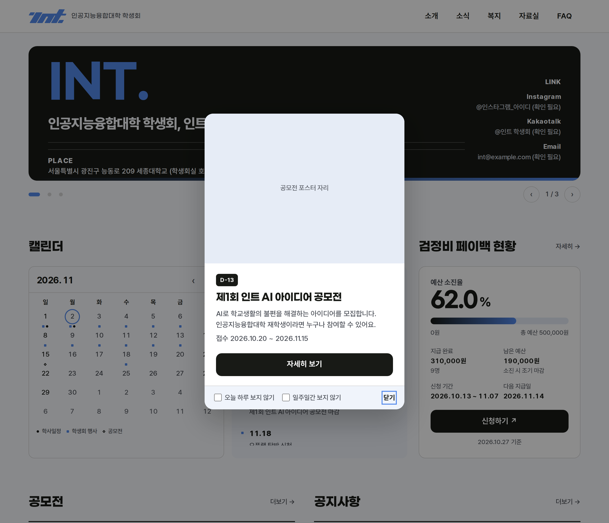
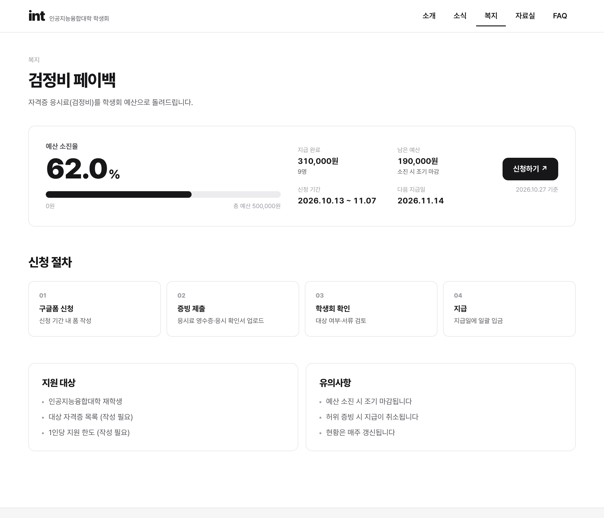
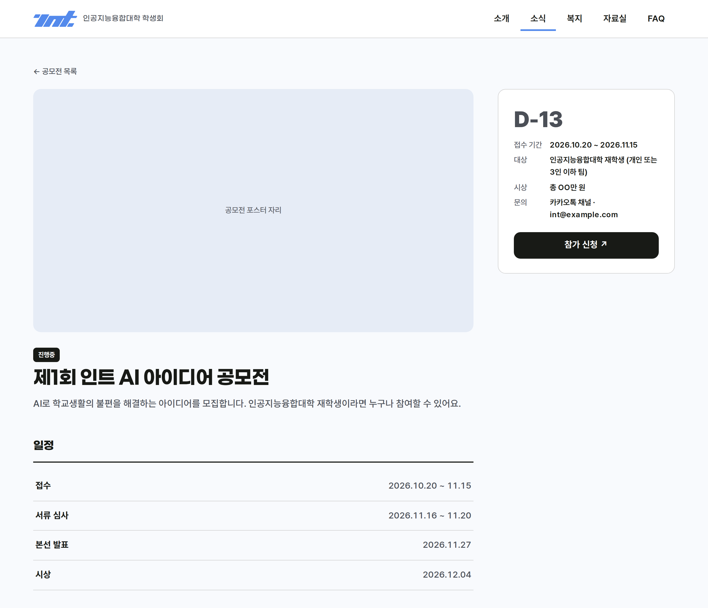
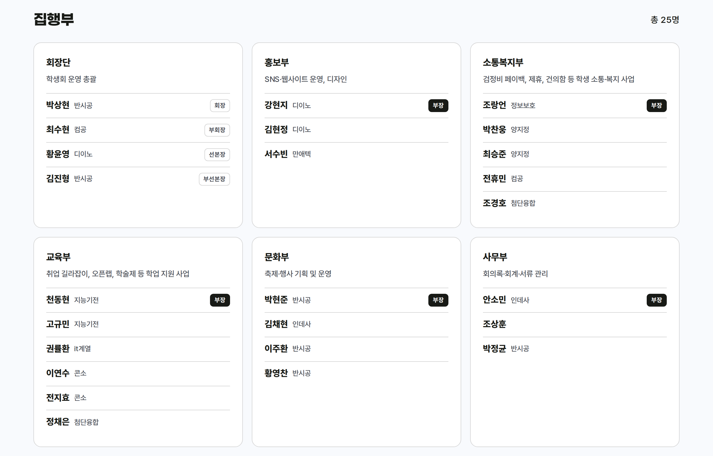
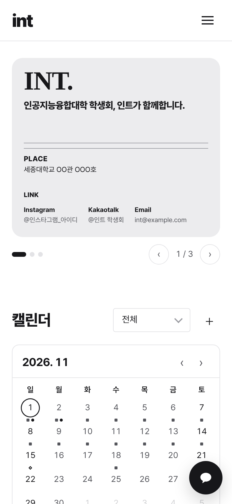
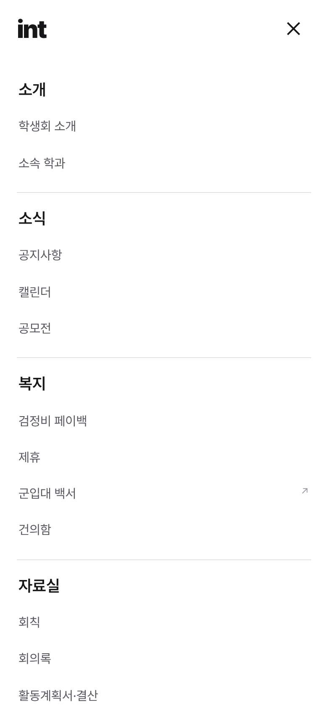

# 인트(int) 웹사이트

[](https://github.com/kokunut/int-website/actions/workflows/ci.yml)

세종대학교 **인공지능융합대학 학생회 인트**의 공식 웹사이트입니다.
공지, 일정, 공모전, 복지 혜택, 자료를 한곳에서 볼 수 있어요.
글은 **노션과 구글**에서 고치면 사이트에 저절로 반영됩니다. 코드를 몰라도 운영할 수 있어요.

## 한눈에 보기

- 📰 **공지사항**: 노션에 글을 쓰면 사이트에 올라옵니다.
- 📅 **캘린더**: 학사일정, 학생회 행사, 공모전 마감일을 한 달력에서 봅니다. 공지에 행사 기간을 적으면 달력에도 자동으로 표시돼요.
- 🏆 **공모전**: 학생회가 여는 공모전은 접수 기간에 메인 화면 팝업으로 알려 줍니다.
- 💸 **검정비 페이백**: 예산이 얼마나 쓰였는지만 공개합니다. 개인정보는 나오지 않아요.
- 🤝 **제휴 · 자료실 · FAQ · 건의함**: 학생들이 자주 찾는 정보를 모아 두었습니다.
- 🔓 **로그인이 없습니다.** 누구나 바로 볼 수 있어요.
- 📱 **휴대폰에서도 잘 보입니다.**

## 화면 둘러보기

아래 화면은 **예시 데이터**로 찍은 것이라 실제 사이트와 내용이 다를 수 있어요.

<table>
  <tr>
    <td width="50%"><br><sub><b>메인 화면</b>: 배너, 캘린더, 페이백 현황이 한눈에 보여요.</sub></td>
    <td width="50%"><br><sub><b>캘린더</b>: 날짜를 누르면 그날 일정이 오른쪽에 나와요.</sub></td>
  </tr>
  <tr>
    <td width="50%"><br><sub><b>공모전 팝업</b>: 접수 기간에만 뜨고, "오늘 하루 보지 않기"를 고를 수 있어요.</sub></td>
    <td width="50%"><br><sub><b>검정비 페이백</b>: 예산 소진율과 신청 방법을 보여 줘요.</sub></td>
  </tr>
  <tr>
    <td width="50%"><br><sub><b>공모전 상세</b>: 일정, 대상, 시상, 신청 버튼이 있어요.</sub></td>
    <td width="50%"><br><sub><b>학생회 소개</b>: 부서별 집행부 명단이에요.</sub></td>
  </tr>
</table>

**휴대폰 화면**

<table>
  <tr>
    <td><br><sub>메인 화면</sub></td>
    <td><br><sub>메뉴 열기(☰)</sub></td>
  </tr>
</table>

## 메뉴 구성

| 메뉴 | 안에 들어 있는 것 |
| --- | --- |
| 소개 | 학생회 소개(조직도·집행부 명단), 소속 학과 |
| 소식 | 공지사항, 캘린더, 공모전 |
| 복지 | 검정비 페이백, 제휴, 건의함 |
| 자료실 | 회칙, 회의록, 활동계획서·결산, 서식 |
| 아카이브 | 취업 아카이브(인융 인터뷰 아카이브 노션 링크 포함), 병영 길라잡이(병역 길라잡이 노션 링크 포함) |
| FAQ | 자주 묻는 질문 |

## 내용은 어떻게 고치나요?

| 바꾸고 싶은 것 | 어디서 고치나요? | 반영 시간 |
| --- | --- | --- |
| 공지사항, 공모전, 제휴, FAQ, 자료실, 메인 배너, 건의 답변 | **노션** 데이터베이스(표 형태의 페이지) | 최대 10분 |
| 학사일정 | **구글 캘린더** | 최대 10분 |
| 검정비 페이백 숫자 | **구글 시트** `요약` 탭 | 최대 10분 |
| 학생회 명단·부서, 인스타그램·카카오·구글폼 링크, 학생회실 주소, 이메일, 인사말·서명·단체 사진 | **노션** `집행부`·`부서`·`사이트 설정` 데이터베이스 | 최대 10분 |
| 학과 소개, 페이지 안내 문구 | 코드 파일(`src/content`) (연 1회 미만 변경, 웹 조사 기반이라 확인 후 일괄 수정) | 개발자에게 요청 ([이슈로 요청하는 법](docs/brain/06-content-ops.md#5-1-사이트-수정-요청하기)) |

- **10분 규칙**: 고친 내용은 10분 안에 사이트에 반영돼요. 바로 보고 싶으면 **강제 새로고침**(캐시를 비우는 명령)을 쓸 수 있습니다. 방법은 아래 매뉴얼 4장을 보세요.
- 노션 표의 **속성 이름은 글자 하나까지 똑같아야** 합니다. 이름을 바꾸면 사이트에서 사라져요.
- 사이트에 보이려면 노션 행에 **`공개` 체크**가 꼭 필요합니다.
- 직접 고치기 어려우면 GitHub **Issues → New issue → 간단 작성**으로 요청하세요. 텍스트 상자 하나에 항목만 채우면 됩니다.

👉 단계별 설명(그림 없이 표로 정리): [`docs/brain/06-content-ops.md`](docs/brain/06-content-ops.md)

## 처음 한 번만: 사이트 열기(배포)

배포는 사이트를 인터넷에 올려서 누구나 볼 수 있게 하는 일이에요. 무료 서비스 **Vercel**을 씁니다. 처음 한 번만 하면 됩니다.

1. [vercel.com](https://vercel.com)에서 GitHub 계정으로 가입합니다.
2. **Add New → Project**를 누르고 이 저장소(`kokunut/int-website`)를 **Import**(불러오기) 합니다.
3. 설정은 기본값 그대로 두고 **Deploy**를 누릅니다. 몇 분 뒤 사이트 주소가 생겨요.
4. 노션·구글을 연결합니다. Vercel의 **Settings → Environment Variables**(환경변수, 비밀번호 같은 설정값을 넣는 곳)에 값을 넣고 **Redeploy**(다시 배포) 합니다. 어떤 값을 어디서 구하는지는 [매뉴얼 2장](docs/brain/06-content-ops.md)에 있어요.
5. 도메인(예: `int.sejong.ac.kr` 같은 주소)을 쓰려면 **Settings → Domains**에서 추가합니다.

> 비밀값(토큰 등)은 **절대 GitHub에 올리지 마세요.** Vercel 환경변수에만 넣습니다.

### 아직 사람이 해야 할 일

> 최신 목록은 항상 [`docs/brain/05-progress.md`](docs/brain/05-progress.md)가 기준입니다. 아래는 참고용 요약이에요.

- [ ] Vercel 프로젝트 연결과 도메인
- [ ] 노션 통합(연동용 계정 같은 것) 만들기, 노션 DB 9개 구성, 구글 시트 `요약` 탭 웹 게시, 캘린더 iCal 주소를 Vercel 환경변수에 등록
- [ ] Vercel에서 **Analytics**와 **Speed Insights** 켜기 (방문 통계)
- [ ] **실제 링크** 확정: 카카오 채널, 인스타그램, 구글폼(페이백 신청·건의함)
- [ ] **학생회실 주소** 확정 (지금은 `OO관 OOO호` 자리표시)
- [ ] 학과 약어 정식 명칭과 집행부 명단(직책, 총원) 확인
- [ ] 색상·로고 확정

지금은 노션·구글을 연결하기 전이라 **예시 데이터**가 보입니다. 연결하면 진짜 내용으로 바뀌어요. 최신 진행 상황은 [`docs/brain/05-progress.md`](docs/brain/05-progress.md)에서 확인하세요.

## 자주 묻는 질문 / 문제 해결

<details>
<summary><b>노션에 글을 올렸는데 사이트에 안 보여요</b></summary>

1. `공개` 칸에 체크했나요?
2. 필수 속성(제목, 날짜 등)이 모두 채워졌나요?
3. 10분은 기다려 봤나요? 급하면 강제 새로고침을 하세요.
4. 그래도 안 되면 매뉴얼 5장의 문제 해결 표를 보세요. 개발자는 `npm run content:check`로 원인을 바로 찾을 수 있어요.
</details>

<details>
<summary><b>색이나 로고를 바꾸고 싶어요</b></summary>

색은 `src/app/globals.css` 맨 위 `:root`(사이트 전체 색을 모아 둔 곳)의 값을 바꾸면 사이트 전체에 적용됩니다. 코드를 건드려야 하니 개발자에게 요청하세요. 지금은 흑백이라 `--accent` 값만 브랜드 색으로 바꿔도 분위기가 크게 달라져요.
</details>

<details>
<summary><b>공모전 팝업이 안 떠요 / 계속 떠요</b></summary>

- **안 떠요**: 노션 팝업 DB 행(또는 `팝업` 체크한 공모전 행)의 `기간` 안에 오늘이 들어 있고, `공개`가 체크되어 있어야 해요. 올리는 방법은 `docs/brain/06-content-ops.md`의 "팝업 올리기"를 보세요. 방문자가 "오늘 하루/일주일간 보지 않기"를 눌렀다면 그 기간엔 뜨지 않습니다.
- **계속 떠요**: 접수 기간이 끝날 때까지는 정상이에요. 팝업을 끄고 싶으면 `팝업` 체크를 풀거나 `공개`를 해제하세요.
</details>

<details>
<summary><b>`dependencies` 라벨이 붙은 PR이 계속 올라와요</b></summary>

사이트가 쓰는 부품(라이브러리)의 새 버전을 알려 주는 자동 업데이트 PR이에요. 모든 검사에 초록 체크가 떠 있으면 머지해도 됩니다. 빨간 표시가 있으면 개발자에게 알려 주세요.
</details>

<details>
<summary><b>방문자 수를 보고 싶어요</b></summary>

Vercel 프로젝트의 **Analytics** 탭(어떤 메뉴를 많이 보는지)과 **Speed Insights** 탭(실제 방문자 기준 속도)에서 볼 수 있어요. 처음 한 번 각 탭에서 **Enable**을 눌러야 합니다. 자세한 방법은 [`docs/brain/06-content-ops.md`](docs/brain/06-content-ops.md)의 "방문 통계 보기"를 보세요.

개인정보: **쿠키를 쓰지 않고 개인을 알아볼 수 있는 정보도 모으지 않습니다.**
</details>

<details>
<summary><b>학생회 명단을 바꾸고 싶어요</b></summary>

노션의 **`인트 · 집행부`** 데이터베이스에서 행을 추가·수정·삭제하면 됩니다(`이름`·`학과`·`부서`·`직책`·`부장`·`순서`, `공개` 체크). 부서 이름·설명은 **`인트 · 부서`** 데이터베이스에서 고칩니다. 최대 10분 안에 사이트에 반영돼요. 자세한 표는 [`docs/brain/06-content-ops.md`](docs/brain/06-content-ops.md) 3-10, 3-11을 보세요.
</details>

<details>
<summary><b>다음 집행부에 인수인계하려면?</b></summary>

1. 이 README와 [`docs/brain/06-content-ops.md`](docs/brain/06-content-ops.md)를 읽게 해 주세요.
2. 노션 워크스페이스, 구글 계정(캘린더·시트), Vercel, GitHub 저장소의 **관리자 권한**을 새 담당자에게 넘기세요.
3. 노션 통합 토큰과 `REVALIDATE_SECRET`은 인수 후 새로 만들고 Vercel에 다시 등록하는 것이 안전해요.
4. 노션 `집행부` 데이터베이스의 행을 새 집행부로 바꾸고, `사이트 설정` 데이터베이스에서 인사말·서명·단체 사진·링크를 확인합니다. 코드를 고칠 필요는 없습니다. 체크리스트는 매뉴얼 6장을 보세요.
</details>

## 개발자 · AI 에이전트용

**스택**: Next.js(App Router) + TypeScript, Vercel 배포, 데이터는 노션 API·구글 캘린더(iCal)·구글 시트(CSV)에서 읽고 10분마다 재생성(ISR). 노션·구글을 연결하지 않으면 `src/content`의 예시 데이터를 씁니다.

```bash
npm install            # 의존성 설치
npm run dev            # 개발 서버 http://localhost:3000
npm run lint           # ESLint
npm run typecheck      # TypeScript 검사
npm test               # 단위 테스트 (Vitest)
npm run build          # 프로덕션 빌드
npm run test:e2e       # E2E 테스트 (Playwright, 빌드·서버 자동 실행)
npm run content:check  # 노션·구글 연동 점검 (.env.local 필요)
npm run screenshots    # README용 화면 캡처 (서버를 먼저 띄운 뒤 실행)
```

E2E는 처음 한 번 `npx playwright install chromium`으로 브라우저를 설치한 뒤 `npm run test:e2e`로 실행합니다.

PR 전에는 `lint`, `typecheck`, `test`, `build`가 모두 통과해야 합니다. 화면 캡처는 `npm run build && npx next start -p 3000`으로 서버를 띄운 뒤 다른 터미널에서 `npm run screenshots`를 실행하면 `docs/images/`에 저장됩니다. (Playwright가 설치되어 있어야 하고, 주소는 `BASE_URL`로 바꿀 수 있어요.)

의존성은 Dependabot이 매주 월요일 PR로 올립니다(`.github/dependabot.yml`). 처리 절차는 [`02-workflow.md`](docs/brain/02-workflow.md)를 보세요.

작업 규칙은 [`AGENTS.md`](AGENTS.md)와 [`docs/brain/`](docs/brain/README.md)(프로젝트 세컨브레인)에 있습니다. 작업 전에 꼭 읽어 주세요.

```text
src/app/        페이지(주소별 화면)
src/components/ 화면 부품(헤더, 캘린더, 팝업 등)
src/content/    예시 데이터와 직접 쓰는 문구(명단, 학과, 링크)
src/lib/        데이터 불러오기, 날짜·팝업 계산, 테스트
scripts/        점검·캡처 스크립트
docs/brain/     기획·결정·운영 매뉴얼
docs/images/    README 화면 캡처
docs/prototype/ 처음 만든 HTML 초안
```

## 초안

처음 만든 단일 HTML 초안은 [`docs/prototype/index_1.html`](docs/prototype/index_1.html)에 보관되어 있습니다. 브라우저로 열면 화면 구성과 동작을 볼 수 있어요. 지금 사이트는 이 초안을 기준으로 만들었습니다.
